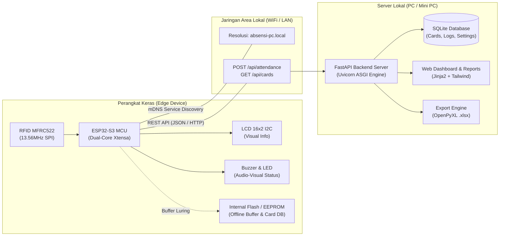

# 📇 ESP32-S3 RFID Attendance System

> **Sistem Presensi RFID Mandiri Berbasis IoT & Local-First Architecture**  
> Solusi presensi cerdas, hemat biaya, dan tahan kendala jaringan dengan integrasi *end-to-end*: **Custom PCB (KiCad) + Embedded C++ (ESP32-S3) + Modern Web Backend (FastAPI & SQLite)**.

[](https://platformio.org/)
[](https://www.espressif.com/)
[](https://fastapi.tiangolo.com/)
[](https://www.python.org/)
[](https://www.sqlite.org/)
[](https://www.kicad.org/)
[](LICENSE)

---

## 📌 Latar Belakang & Masalah (*Problem Statement*)

Banyak institusi, sekolah, laboratorium, maupun startup menghadapi berbagai kendala dalam pencatatan kehadiran:
1. **Absensi Manual / Kertas**: Rawan manipulasi, rawan hilang, dan memakan waktu rekapitulasi yang tinggi.
2. **Mesin Biometrik (Fingerprint) Konvensional**: Sering gagal mengenali sidik jari yang kotor, berminyak, atau basah; menimbulkan antrean panjang di jam sibuk kerja/sekolah.
3. **Sistem Cloud Murni (*Pure Cloud-Dependent*)**: Jika koneksi internet ISP luar mati (*down*) atau latensi tinggi, seluruh proses absensi di kantor menjadi lumpuh dan karyawan tidak bisa tap kartu.
4. **Konfigurasi Jaringan yang Rumit**: Perangkat IoT tradisional sering mengharuskan pengaturan IP statis (*hardcoded*) pada firmware setiap kali berpindah router/jaringan.

---

## 💡 Solusi yang Ditawarkan (*The Engineering Solution*)

Proyek ini menghadirkan **arsitektur presensi lokal-mandiri (*Local-First & Offline-Resilient*)** yang andal dan mudah dioperasikan tanpa ketergantungan pada internet publik:

- 🛡️ **Offline-First & Auto-Synchronization**:  
  ESP32-S3 menyimpan daftar UID kartu aktif di memori EEPROM/Flash. Jika server PC atau jaringan mati, proses *tap* tetap berhasil dicatat ke dalam memori *offline buffer* lokal (LittleFS/RAM). Begitu server kembali online, data transaksi otomatis terkirim tanpa ada absensi yang hilang.
- 🔍 **Zero-Configuration Network (mDNS Discovery)**:  
  ESP32 secara cerdas mencari keberadaan server PC lokal di jaringan menggunakan protokol mDNS (`absensi-pc.local`). Pengguna tidak perlu mengubah kode atau mengatur IP statis saat berganti router.
- 📶 **WiFi Captive Portal (WiFiManager)**:  
  Konfigurasi SSID dan password dilakukan melalui halaman *web portal* saat ESP32 pertama kali dinyalakan atau saat jaringan berubah, tanpa perlu *flash* ulang firmware.
- ⏱️ **Double-Tap Debounce Protection**:  
  Backend FastAPI dilengkapi proteksi logika selisih waktu (<10 detik) untuk mencegah terjadinya duplikasi data saat karyawan menempelkan kartu berulang kali tanpa sengaja.
- 🔊 **Feedback Visual & Audio Real-Time**:  
  Respon instan kepada pengguna melalui LCD 16x2 I2C (nama karyawan dan status Masuk/Pulang), lampu status Dual LED, dan nada Buzzer spesifik (sukses vs ditolak).
- 📊 **Dashboard Interaktif & One-Click Excel Export**:  
  Admin dapat memantau log kehadiran secara *real-time*, mendaftarkan kartu baru via browser, dan mengekspor laporan lengkap ke format Microsoft Excel (`.xlsx`) siap olah.
- 🛠️ **Full-Stack Hardware-to-Software**:  
  Dirancang dari level sirkuit elektronik (desain skematik & PCB di KiCad), enclosure 3D print, hingga *full-stack software*.

---

## 🏗️ Arsitektur Sistem

Berikut adalah gambaran interaksi antara komponen perangkat keras dan aplikasi server:



> 📖 **Pelajari detail alur sistem & flowchart lengkap:** [docs/architecture_flowchart.md](docs/architecture_flowchart.md)

---

## ✨ Fitur-Fitur Utama

### 1. Sisi Firmware (ESP32-S3)
* **Dual-State Attendance Toggle**: Menentukan otomatis pergantian status `IN` (Masuk) atau `OUT` (Keluar).
* **NTP Clock Synchronization**: Jam internal tersinkronisasi otomatis via NTP (*Network Time Protocol*).
* **Smart Offline Buffer Recovery**: Mengirim antrean data luring secara otomatis begitu koneksi ke server pulih.
* **Modular Codebase**: Kode C++ tertata rapi dalam modul terpisah (`wifi_manager`, `rfid_handler`, `pc_client`, `offline_buffer`, `lcd_display`, `led_buzzer`).

### 2. Sisi Server & Web App (FastAPI)
* **Realtime Dashboard**: Menampilkan status kehadiran hari ini, waktu *tap*, serta rincian karyawan.
* **Interactive Enrollment Mode**: Pendaftaran kartu baru langsung dari web browser. Saat mode aktivasi menyala, kartu yang di-tap otomatis terdaftar ke profil pegawai baru.
* **Audit & Export Excel**: Unduh rekapitulasi presensi harian/bulanan dengan format rapi dan siap cetak.
* **Lightweight & High Performance**: Dibangun menggunakan FastAPI asynchronous dengan SQLite yang ringan dan mudah di-backup.

### 3. Sisi Hardware & PCB
* **Custom KiCad Design**: Skematik dan layout 2-layer siap cetak (*home-etching* toner transfer atau fabrikasi JLCPCB/PCBWay).
* **Decoupling Protection**: Dilengkapi kapasitor peredam *noise* pada jalur suplai daya MFRC522 dan ESP32.
* **Mounting Enclosure Ready**: Dimensi PCB 100×80 mm dirancang presisi untuk box/casing 3D print.

---

## 🧰 Kebutuhan Komponen (Hardware & Software)

### Komponen Elektronika
| Komponen | Spesifikasi / Tipe | Fungsi |
|---|---|---|
| **Microcontroller** | ESP32-S3 DevKitC-1 (WiFi + BLE) | Pemroses utama, konektivitas, buffer memori |
| **RFID Reader** | MFRC522 (13.56 MHz, SPI Interface) | Pembaca kartu RFID MIFARE |
| **Display** | LCD 16x2 Karakter dengan I2C Backpack | Penampil jam, sapaan nama, dan status |
| **Audio-Visual** | Active Buzzer 5V, LED Hijau, LED Merah | Indikator status sukses / ditolak |
| **Kartu/Tag** | MIFARE Classic 1K Card / Keyfob | Identitas pengguna / karyawan |
| **Catu Daya** | 5V DC (USB-C atau Adaptor 5V 1A) | Sumber daya sistem |

### Perangkat Lunak & Library
* **Firmware**: PlatformIO IDE, Arduino Framework for ESP32, LittleFS, ArduinoJson, MFRC522, LiquidCrystal_I2C, WiFiManager.
* **PC Backend**: Python 3.12+, FastAPI, Uvicorn, SQLAlchemy, SQLite, OpenPyXL, python-zeroconf.
* **EDA / PCB Tool**: KiCad 8.0+.

---

## 🚀 Panduan Memulai Cepat (*Quick Start*)

### 1. Flash Firmware ke ESP32-S3
Pastikan Anda telah memasang [PlatformIO Core / IDE](https://platformio.org/).

```bash
# Masuk ke direktori firmware
cd firmware

# Compile dan upload ke board ESP32-S3
pio run -t upload

# Buka Serial Monitor untuk memantau proses boot
pio device monitor
```

### 2. Menjalankan Server PC (FastAPI)
Buka terminal baru di komputer yang terhubung ke jaringan WiFi/LAN yang sama:

```bash
# Masuk ke direktori pc-app
cd pc-app

# Buat virtual environment (opsional namun disarankan)
python -m venv venv
# Windows:
venv\Scripts\activate
# Linux/macOS:
# source venv/bin/activate

# Install dependensi
pip install -r requirements.txt

# Jalankan server FastAPI
uvicorn app.main:app --host 0.0.0.0 --port 8000
```

### 3. Mengakses Web Dashboard
Buka browser web di komputer Anda lalu akses salah satu alamat berikut:
- 🌐 `http://localhost:8000`
- 🌐 `http://absensi-pc.local:8000`

---

## 📂 Struktur Repositori

```text
projek_absensi_rfid/
├── firmware/                  # Proyek Firmware PlatformIO (ESP32-S3)
│   ├── src/                   # Source code modular C++
│   │   ├── main.ino           # Logika utama (setup & loop)
│   │   ├── config.h           # Pemetaan pin hardware & parameter sistem
│   │   ├── rfid_handler.cpp   # Driver komunikasi MFRC522 (SPI)
│   │   ├── pc_client.cpp      # Klien HTTP REST API ke server PC
│   │   ├── mdns_client.cpp    # Resolusi nama server otomatis (mDNS)
│   │   ├── offline_buffer.cpp # Manajemen buffer antrean offline
│   │   ├── card_storage.cpp   # Cache UID kartu lokal pada Flash
│   │   └── ...
│   ├── include/               # Header deklarasi
│   └── platformio.ini         # Konfigurasi board & dependensi library
├── pc-app/                    # Aplikasi Server & Web (FastAPI)
│   ├── app/
│   │   ├── main.py            # Entry point FastAPI & zeroconf mDNS advertiser
│   │   ├── database.py        # Konfigurasi database SQLite & ORM engine
│   │   ├── models.py          # Model database: Card & AttendanceLog
│   │   ├── routes/            # REST API endpoints (cards, attendance, reports)
│   │   ├── services/          # Layanan mDNS broadcast & sync logic
│   │   ├── templates/         # UI Dashboard HTML (Jinja2)
│   │   └── static/            # Styling CSS & aset web
│   ├── tests/                 # Unit testing (Pytest)
│   └── requirements.txt       # Daftar dependensi Python
├── pcb/                       # Desain Perangkat Keras PCB (KiCad)
│   └── rfid-attendance/       # File skematik (.kicad_sch), PCB (.kicad_pcb),
│                              # dan berkas export SVG siap cetak
├── case/                      # File rancangan 3D enclosure / casing
├── docs/                      # Dokumentasi Teknis Mendalam
│   ├── architecture_flowchart.md # Diagram alur data & state machine lengkap
│   ├── setup-guide.md            # Panduan langkah demi langkah untuk teknisi & user
│   └── wiring.md                 # Diagram skematik pinout hardware & kelistrikan
└── README.md                  # Halaman utama dokumentasi proyek
```

---

## 📚 Panduan Dokumentasi Lengkap

Untuk eksplorasi teknis yang lebih komprehensif, silakan pelajari dokumen-dokumen berikut:
- 📐 [**Diagram Pengkabelan & Pinout (Wiring)**](docs/wiring.md) — Rincian jalur pin SPI/I2C/GPIO, level voltase, dan panduan kestabilan daya.
- ⚙️ [**Arsitektur & Flowchart Sistem**](docs/architecture_flowchart.md) — Alur logika state machine, penanganan offline buffer, dan kontrak API.
- 📖 [**Panduan Penggunaan & Troubleshooting**](docs/setup-guide.md) — Langkah operasional bagi pengguna non-teknis serta matriks penanganan masalah.
- 🔌 [**Dokumentasi Desain PCB & Fabrikasi**](pcb/rfid-attendance/README.md) — Spesifikasi PCB 2-layer, Bill of Materials (BOM), dan panduan cetak KiCad.

---

## 👨‍💻 Kontribusi & Lisensi

Proyek ini dirilis di bawah lisensi terbuka [MIT License](LICENSE). Bebas digunakan, dimodifikasi, dan dikembangkan untuk keperluan riset, edukasi, maupun implementasi komersial.
