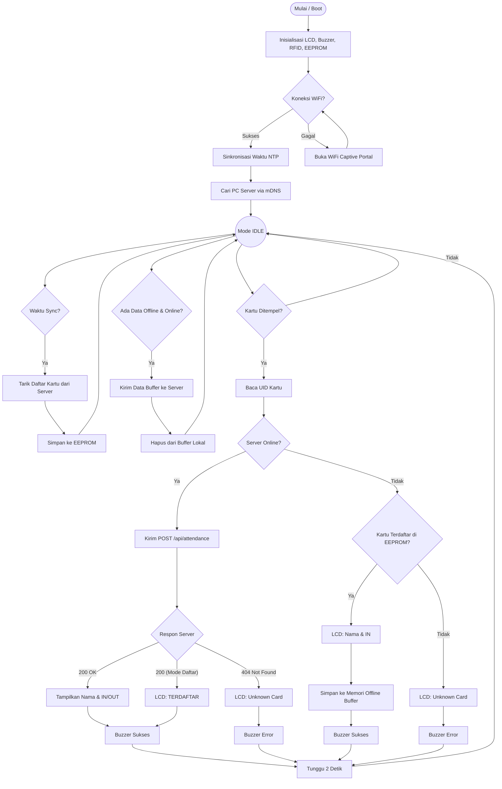
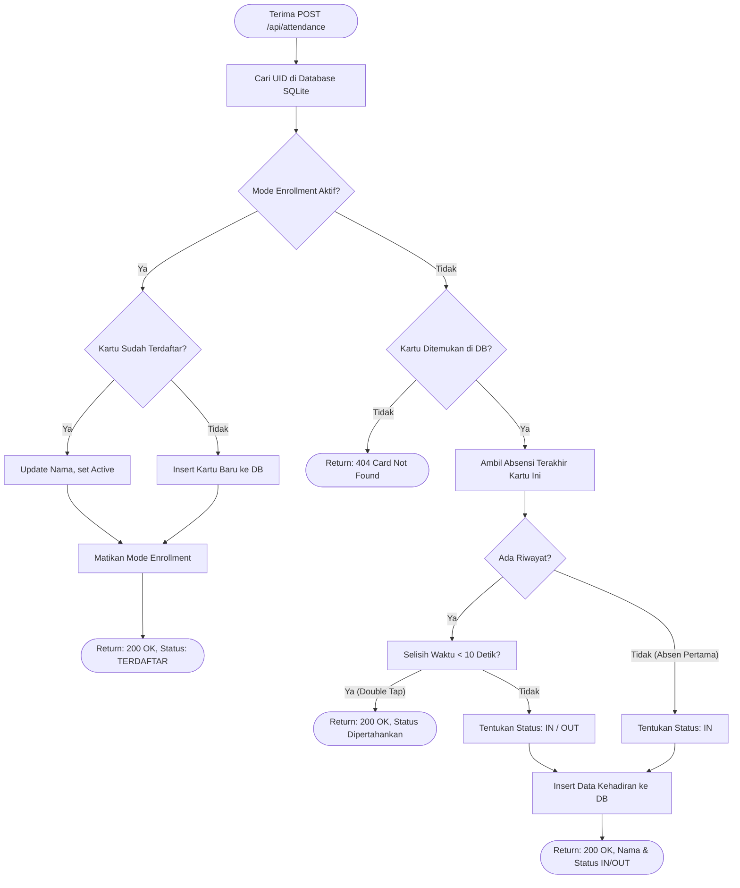

# Arsitektur & Flowchart Sistem Absensi RFID

Dokumen ini memuat diagram alir (*flowchart*) yang mendeskripsikan cara kerja dari dua komponen utama sistem kita: **Firmware (ESP32)** dan **PC-App (FastAPI Backend)**.

## 1. Flowchart Firmware (ESP32)
Flowchart di bawah ini menjelaskan alur program dari saat perangkat dinyalakan (*boot*) hingga ia membaca kartu (Online maupun Offline).

---

## 2. Flowchart PC-App (FastAPI Backend)
Flowchart ini mendeskripsikan logika yang berjalan di *Server* (Komputer PC Anda) saat menerima kiriman data tap kartu dari ESP32 (API Endpoint: `POST /api/attendance`).

## Kesimpulan Logika Inti:
1. **Pemisahan Tanggung Jawab:** ESP32 bertindak sebagai *client* pengumpul data dan penampil status, sementara PC-App menanggung beban logika utama (Double-Tap, Penentuan IN/OUT, Pendaftaran Kartu).
2. **Offline-Safe:** ESP32 dapat berdiri sendiri saat WiFi atau PC-App mati berkat adanya penyalinan data UID ke *EEPROM* dan penyimpanan catatan absen di memori lokal (*Offline Buffer*).
