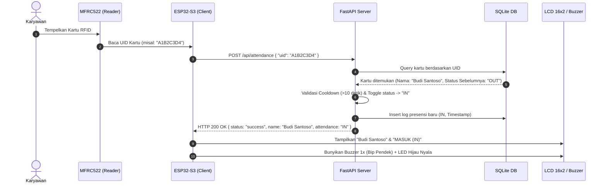
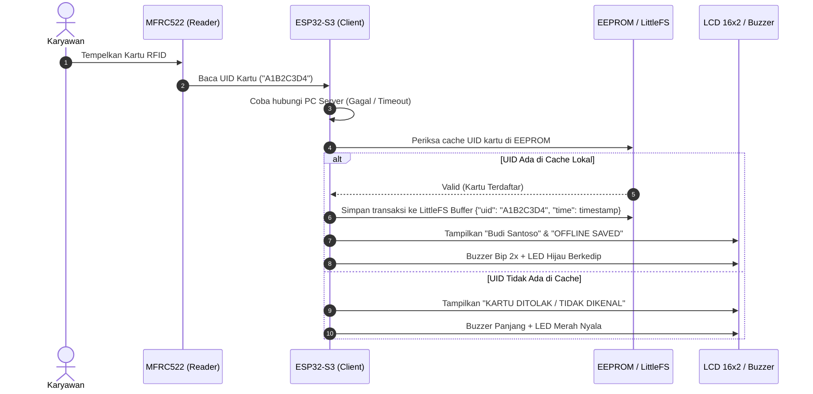
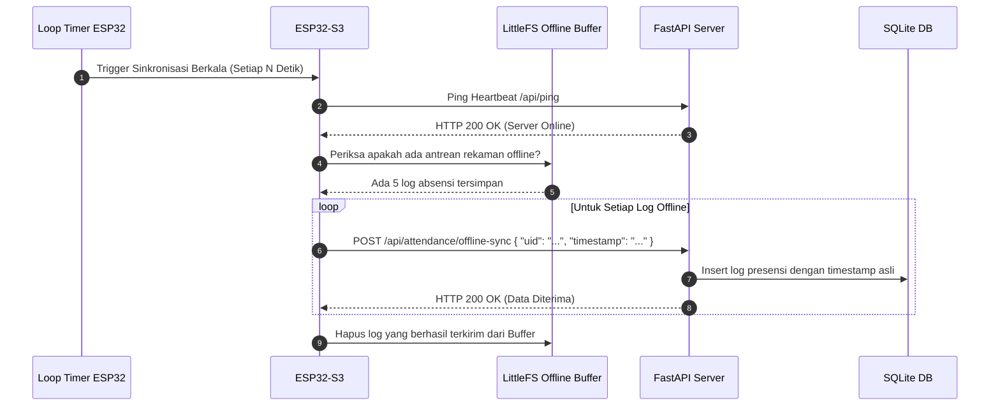
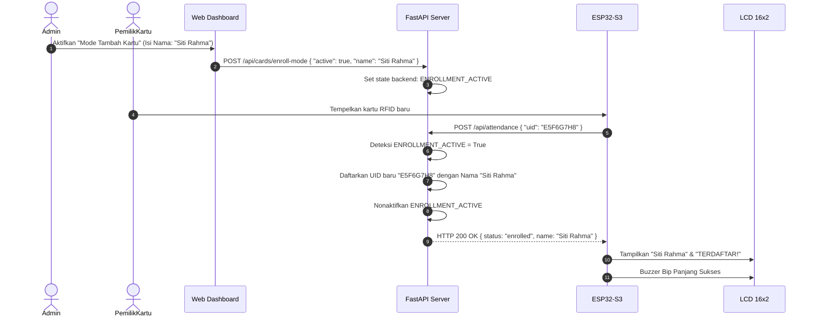
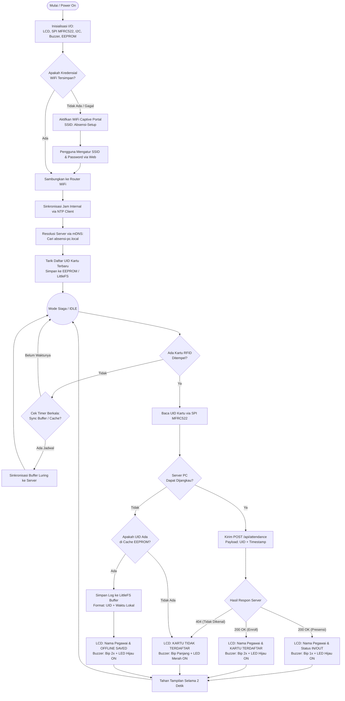
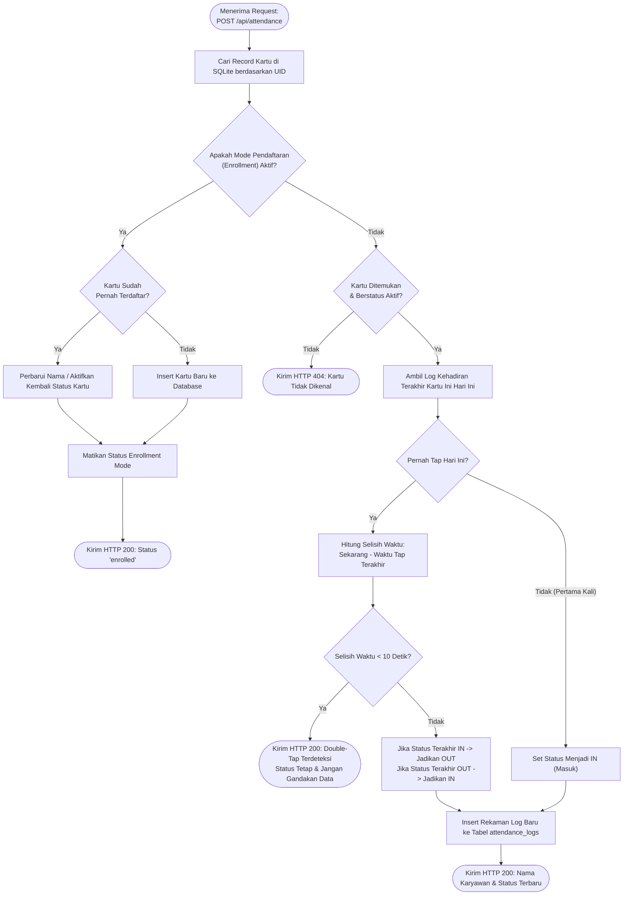

# 🏛️ Arsitektur & Diagram Alur Sistem (Architecture & Flowchart)

Dokumen ini menguraikan secara mendalam bagaimana **ESP32-S3 RFID Attendance System** bekerja. Sistem ini menerapkan pola **Local-First Architecture** dengan pemisahan tanggung jawab (*Separation of Concerns*) yang jelas antara perangkat keras mikrokontroler (*edge device*) dan server komputer lokal (*backend server*).

---

## 📑 Daftar Isi
1. [Prinsip Desain & Arsitektur Sistem](#1-prinsip-desain--arsitektur-sistem)
2. [Diagram Interaksi Komunikasi (Sequence Diagram)](#2-diagram-interaksi-komunikasi-sequence-diagram)
   - [A. Skenario Normal (Online Tap)](#a-skenario-normal-online-tap)
   - [B. Skenario Putus Jaringan (Offline Buffering)](#b-skenario-putus-jaringan-offline-buffering)
   - [C. Skenario Pemulihan Koneksi (Auto-Sync)](#c-skenario-pemulihan-koneksi-auto-sync)
   - [D. Skenario Pendaftaran Kartu Baru (Enrollment Mode)](#d-skenario-pendaftaran-kartu-baru-enrollment-mode)
3. [Flowchart Logika Firmware (ESP32-S3)](#3-flowchart-logika-firmware-esp32-s3)
4. [Flowchart Logika Server Backend (FastAPI)](#4-flowchart-logika-server-backend-fastapi)
5. [Spesifikasi Kontrak REST API](#5-spesifikasi-kontrak-rest-api)

---

## 1. Prinsip Desain & Arsitektur Sistem

Sistem ini dirancang untuk mengatasi kelemahan mendasar dari sistem presensi IoT konvensional yang sering lumpuh saat koneksi jaringan terputus.

| Aspek Desain | Pendekatan Sistem Ini | Manfaat Rekayasa |
|---|---|---|
| **Ketergantungan Jaringan** | *Local-First with Offline Fallback* | Karyawan tetap bisa melakukan tap kartu meskipun PC server atau router WiFi mati. |
| **Pencarian Alamat Server** | *Zero-Config Discovery* via mDNS | ESP32 mendeteksi IP server secara dinamis melalui nama host `absensi-pc.local`, tanpa perlu IP statis. |
| **Manajemen Konfigurasi WiFi** | *Captive Portal On-Demand* (WiFiManager) | Mengganti SSID/Password tanpa harus memprogram ulang (*reflashing*) mikrokontroler. |
| **Pencegahan Data Dobel** | *Cooldown Debounce Algorithm* (< 10 detik) | Mencegah terbuatnya log ganda akibat kartu tertempel dua kali secara tidak sengaja. |
| **Penyimpanan Transaksi** | Dual-Tier (EEPROM Cache + SQLite Server) | Transaksi dijamin tersimpan aman di server dengan integritas ACID SQLite. |

---

## 2. Diagram Interaksi Komunikasi (Sequence Diagram)

### A. Skenario Normal (Online Tap)
Saat ESP32 dan PC Server terhubung ke jaringan LAN yang sama:



---

### B. Skenario Putus Jaringan (Offline Buffering)
Saat router WiFi atau server PC mati, ESP32 beralih ke mode mandiri (*offline-safe*):



---

### C. Skenario Pemulihan Koneksi (Auto-Sync)
Setelah server PC kembali hidup, ESP32 otomatis mengalirkan data antrean luring:



---

### D. Skenario Pendaftaran Kartu Baru (Enrollment Mode)
Admin mengaktifkan tombol pendaftaran kartu di web dashboard:



---

## 3. Flowchart Logika Firmware (ESP32-S3)

Diagram berikut menjelaskan siklus hidup (*lifecycle*) program firmware mulai dari proses booting hingga penanganan pembacaan kartu di `main.ino`:



---

## 4. Flowchart Logika Server Backend (FastAPI)

Diagram berikut memetakan keputusan logika di sisi backend komputer saat menerima data dari endpoint `POST /api/attendance`:



---

## 5. Spesifikasi Kontrak REST API

Server PC mengekspos endpoint API berbasis JSON dengan standar status kode HTTP:

### `POST /api/attendance`
Dipanggil oleh ESP32 saat mendeteksi tap kartu.
- **Request Body**:
  ```json
  {
    "uid": "4A12B890"
  }
  ```
- **Response (200 OK - Presensi Berhasil)**:
  ```json
  {
    "status": "success",
    "name": "Budi Santoso",
    "attendance_type": "IN",
    "timestamp": "2026-09-12T08:00:15"
  }
  ```
- **Response (404 Not Found - Kartu Tidak Dikenal)**:
  ```json
  {
    "status": "error",
    "message": "Card UID 4A12B890 is not registered"
  }
  ```

### `GET /api/cards`
Mengambil seluruh daftar kartu aktif untuk disinkronisasikan ke memori lokal ESP32.
- **Response (200 OK)**:
  ```json
  [
    { "uid": "4A12B890", "name": "Budi Santoso", "is_active": true },
    { "uid": "E5F6G7H8", "name": "Siti Rahma", "is_active": true }
  ]
  ```

### `POST /api/attendance/offline-sync`
Mengunggah data transaksi yang tersimpan di buffer lokal ESP32 saat luring.
- **Request Body**:
  ```json
  {
    "uid": "4A12B890",
    "recorded_at": "2026-09-12T08:05:00"
  }
  ```
- **Response (200 OK)**:
  ```json
  {
    "status": "synced",
    "uid": "4A12B890"
  }
  ```
